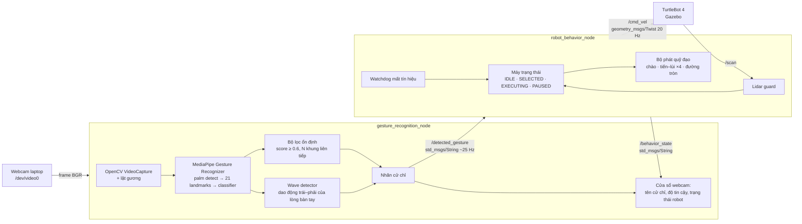
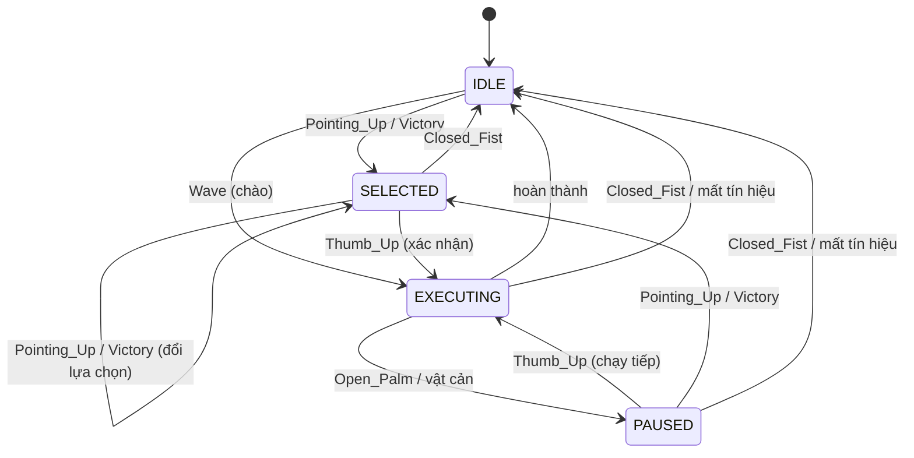

# TurtleBot 4 Gesture Control — Giao tiếp phi ngôn ngữ bằng cử chỉ tay

**Bài tập 6 – Non-verbal Human–Robot Interaction Using Hand Gesture Recognition**

Webcam laptop → OpenCV → **MediaPipe Gesture Recognizer** → ROS 2 Humble → TurtleBot 4 trong Gazebo (Ignition Fortress).
Robot chào lại khi vẫy tay, chọn hành vi bằng 1/2 ngón tay, chỉ chạy sau khi giơ ngón cái xác nhận, dừng ngay khi xòe bàn tay, hủy khi nắm tay, và tự dừng khi mất tín hiệu điều khiển.
- MSSV: 23020747
- 🎬 Video demo: `<link Google Drive>`

---

## 1. Kiến trúc hệ thống



### Node & Topic

| Node | Subscribe | Publish | Vai trò |
|---|---|---|---|
| `gesture_recognition_node` | `/behavior_state` | `/detected_gesture` (`std_msgs/String`) | Đọc webcam, nhận diện cử chỉ, lọc nhiễu, phát nhãn **mỗi khung hình** (đồng thời là tín hiệu heartbeat), hiển thị kết quả |
| `robot_behavior_node` | `/detected_gesture`, `/scan` | `/cmd_vel` (`geometry_msgs/Twist`), `/behavior_state` | Máy trạng thái, phát vận tốc theo kế hoạch, watchdog, chống va chạm |
| `camera_test_node` | – | – | Phần 1: kiểm tra đọc/hiển thị webcam bằng OpenCV |

### Mô hình nhận diện (MediaPipe Gesture Recognizer)

Pipeline 3 tầng chạy trên CPU, chế độ `VIDEO` (có tracking giữa các khung nên nhẹ hơn chạy từng ảnh):

1. **Palm detector** – tìm vùng bàn tay trong ảnh (chỉ chạy lại khi tracking mất).
2. **Hand landmark model** – hồi quy 21 điểm khớp tay (x, y chuẩn hoá 0–1 theo kích thước ảnh, z tương đối).
3. **Gesture classifier** – mạng nhỏ nhận embedding từ landmark, phân loại 8 lớp có sẵn: `None, Closed_Fist, Open_Palm, Pointing_Up, Thumb_Down, Thumb_Up, Victory, ILoveYou` kèm điểm tin cậy.

MediaPipe **không có lớp “Wave”** vì vẫy tay là cử chỉ *động*. Node tự nhận diện Wave: khi lớp hiện tại là `Open_Palm`, lấy tâm lòng bàn tay (trung bình landmark 0, 5, 9, 13, 17) và đếm số lần đổi chiều chuyển động ngang với biên độ ≥ 6 % bề rộng ảnh trong cửa sổ 1,5 s. Đủ 3 nhịp (trái–phải–trái) → `Wave`.

→ Hệ thống nhận diện được **8 cử chỉ** (7 lớp tĩnh + Wave), trong đó 6 cử chỉ dùng để điều khiển.

---

## 2. Bảng ánh xạ cử chỉ → hành vi

| Cử chỉ | Nhãn ROS | Hành vi robot | Ghi chú |
|---|---|---|---|
| 👋 Vẫy tay | `Wave` | Xoay sang trái 34° → sang phải 34° → về giữa, lặp 2 lần (chào lại) | Chỉ khi robot đang IDLE; chạy ngay (đặt `wave_requires_confirm: true` nếu muốn bắt buộc xác nhận) |
| ☝️ Giơ 1 ngón | `Pointing_Up` | **Chọn** hành vi tiến 0,4 m – lùi 0,4 m × 4 lần | Robot chưa chạy, chờ xác nhận |
| ✌️ Giơ 2 ngón | `Victory` | **Chọn** hành vi đi vòng tròn r = 0,5 m (v = 0,2 m/s, ω = 0,4 rad/s, 1 vòng ≈ 15,7 s) | Robot chưa chạy, chờ xác nhận |
| 👍 Ngón cái | `Thumb_Up` | **Xác nhận** → thực hiện hành vi đã chọn; nếu đang PAUSED thì chạy tiếp | Bỏ qua nếu chưa chọn gì |
| ✋ Xòe bàn tay | `Open_Palm` | **Dừng ngay** (EXECUTING → PAUSED, giữ hành vi đã chọn) | Phản ứng nhanh hơn (3 khung), không bị cooldown |
| ✊ Nắm tay | `Closed_Fist` | **Hủy** hành vi, xoá lựa chọn, về IDLE | Không bị cooldown |

### Máy trạng thái



### Chống nhiễu & an toàn

| Cơ chế | Ở đâu | Cách hoạt động |
|---|---|---|
| Ngưỡng tin cậy | gesture node | `score < 0.6` → coi như `None` |
| Bỏ phiếu theo thời gian | gesture node | Nhãn phải giữ **6 khung liên tiếp** (~0,25 s) mới được công nhận; `Open_Palm`/`Closed_Fist` chỉ cần 3 khung để dừng nhanh |
| Khoá Wave | gesture node | Sau khi phát `Wave`, lòng bàn tay còn mở không bị hiểu thành lệnh dừng cho đến khi hạ tay |
| Kích hoạt theo sườn (edge trigger) | behavior node | Chỉ xử lý khi nhãn **thay đổi**; giữ nguyên cử chỉ không kích hoạt lặp lại |
| Cooldown | behavior node | Cùng một lệnh không được chấp nhận lại trong 1 s (trừ dừng/hủy) |
| Bắt buộc xác nhận | behavior node | Hành vi đã chọn chỉ chạy sau `Thumb_Up`; khi đang chạy không đổi lựa chọn được |
| Watchdog | behavior node | Không nhận `/detected_gesture` quá 1 s (webcam rút ra, node chết, đóng cửa sổ) → dừng, về IDLE |
| Lidar guard | behavior node | Có vật cản < 0,30 m trong hình nón ±35° theo hướng đang đi → PAUSED |
| Giới hạn vận tốc | behavior node | |v| ≤ 0,3 m/s, |ω| ≤ 1,5 rad/s; gửi Twist 0 khi dừng và khi tắt node |

Quỹ đạo được thiết kế **cân bằng**: tiến–lùi có độ dời tổng = 0, chào có góc quay tổng = 0, vòng tròn quay về điểm đầu → robot luôn ở trong vùng ~1,2 m × 1,2 m quanh vị trí xuất phát.

---

## 3. Cài đặt

Yêu cầu: Ubuntu 22.04, ROS 2 Humble, TurtleBot 4 Simulator, webcam.

### 3.1 TurtleBot 4 Simulator (bỏ qua nếu đã cài ở bài trước)

```bash
sudo apt update
sudo apt install -y ros-humble-turtlebot4-simulator ros-humble-irobot-create-nodes v4l-utils
```

### 3.2 MediaPipe

Cài vào Python hệ thống (không dùng venv để `ros2 run` thấy được thư viện). Ghim `numpy<2` để không làm hỏng các gói ROS Humble được build với NumPy 1.x:

```bash
pip3 install --user "mediapipe==0.10.21" "numpy<2"
python3 -c "import mediapipe, numpy, cv2; print(mediapipe.__version__, numpy.__version__, cv2.__version__)"
```

### 3.3 Build package

```bash
mkdir -p ~/tb4_gesture_ws/src && cd ~/tb4_gesture_ws/src
git clone https://github.com/<username>/tb4-gesture-control.git
cd tb4-gesture-control
./scripts/download_model.sh          # tải models/gesture_recognizer.task (~8 MB)

cd ~/tb4_gesture_ws
source /opt/ros/humble/setup.bash
colcon build --symlink-install
source install/setup.bash
```

> Phải tải model **trước** khi `colcon build` để file được cài vào `share/`. Nếu tải sau thì build lại, hoặc chạy với `-p model_path:=/đường/dẫn/gesture_recognizer.task`.

Kiểm thử logic (không cần ROS/webcam): `python3 -m pytest src/tb4-gesture-control/test -q`

---

## 4. Chạy chương trình

Mỗi terminal mới: `source /opt/ros/humble/setup.bash && source ~/tb4_gesture_ws/install/setup.bash`

### Phần 1 – Simulation, `/cmd_vel` và webcam

**Terminal 1 – Gazebo:**
```bash
ros2 launch turtlebot4_ignition_bringup turtlebot4_ignition.launch.py
```
Robot xuất hiện trên dock. Đợi Gazebo tải xong rồi bấm ▶ (Play) nếu mô phỏng đang tạm dừng.

**Terminal 2 – rời dock và kiểm tra robot nhận lệnh vận tốc:**
```bash
ros2 action send_goal /undock irobot_create_msgs/action/Undock "{}"
ros2 topic info /cmd_vel                         # có subscriber của robot
ros2 topic pub -r 10 -t 50 /cmd_vel geometry_msgs/msg/Twist "{linear: {x: 0.2}}"
```
Lệnh cuối cho robot tiến ~1 m (5 s × 0,2 m/s) — vừa chứng minh `/cmd_vel` hoạt động, vừa đưa robot ra xa dock tới vùng trống để demo.

**Kiểm tra webcam bằng OpenCV:**
```bash
v4l2-ctl --list-devices                          # xem webcam là /dev/video?
ros2 run turtlebot4_gesture_control camera_test_node --ros-args -p camera_index:=0
```

### Phần 2 + 3 – Nhận diện cử chỉ và điều khiển robot

**Terminal 3:**
```bash
ros2 launch turtlebot4_gesture_control gesture_control.launch.py camera_index:=0
```
Launch khởi động cả hai node. Cửa sổ webcam hiện tên cử chỉ + độ tin cậy, nhãn đã công bố, tiến độ vẫy tay, trạng thái robot (viền màu: xám IDLE, vàng SELECTED, xanh EXECUTING, đỏ PAUSED) và bảng chú giải.

Chạy riêng từng node nếu muốn:
```bash
ros2 run turtlebot4_gesture_control gesture_recognition_node --ros-args -p camera_index:=0
ros2 run turtlebot4_gesture_control robot_behavior_node --ros-args -p use_sim_time:=true
```

**Theo dõi (tuỳ chọn):**
```bash
ros2 topic echo /detected_gesture
ros2 topic echo /behavior_state
ros2 topic hz /cmd_vel
rqt_graph
```

---

## 5. Kịch bản quay video demo

Bố trí màn hình: Gazebo (trái) + cửa sổ webcam (phải) + terminal log (dưới). Không mở teleop, không chạm bàn phím trong lúc demo.

1. **Wave** → robot xoay trái–phải chào lại → tự về IDLE.
2. **Thumb_Up** khi chưa chọn gì → log `ignored Thumb_Up: no behaviour selected`, robot đứng yên (chứng minh cần chọn trước).
3. **Pointing_Up** → trạng thái `SELECTED FORWARD_BACKWARD`, robot **chưa** chạy → **Thumb_Up** → tiến–lùi 4 lần.
4. **Victory** → **Thumb_Up** → robot chạy vòng tròn → giữa chừng **Open_Palm** → robot dừng ngay (PAUSED) → **Thumb_Up** → chạy tiếp đến hết vòng.
5. **Victory** → **Thumb_Up** → **Closed_Fist** → hủy, về IDLE.
6. Chống nhiễu: lướt tay nhanh qua nhiều cử chỉ → nhãn “Published” không đổi, robot không phản ứng; log `ignored ... (cooldown)` khi lặp lệnh quá nhanh.
7. Mất tín hiệu: cho robot chạy vòng tròn rồi **đóng cửa sổ webcam bằng chuột** (hoặc rút webcam USB) → sau 1 s log `no /detected_gesture ... -> STOP`, robot dừng.

---

## 6. Tham số chính (`config/params.yaml`)

| Tham số | Mặc định | Ý nghĩa |
|---|---|---|
| `camera_index` | 0 | Webcam `/dev/videoN` (cũng truyền được qua launch arg) |
| `min_score` | 0.6 | Ngưỡng tin cậy |
| `stable_frames` / `stop_frames` | 6 / 3 | Số khung liên tiếp để công nhận cử chỉ thường / dừng |
| `wave_amplitude`, `wave_swings`, `wave_window` | 0.06, 3, 1.5 s | Độ nhạy vẫy tay |
| `signal_timeout` | 1.0 s | Thời gian mất tín hiệu trước khi dừng |
| `cooldown` | 1.0 s | Khoảng cách tối thiểu giữa hai lần cùng một lệnh |
| `fb_speed`, `fb_distance`, `fb_repeats` | 0.2 m/s, 0.4 m, 4 | Tiến–lùi |
| `circle_speed`, `circle_radius`, `circle_laps` | 0.2 m/s, 0.5 m, 1 | Vòng tròn |
| `obstacle_stop_distance` | 0.30 m | Khoảng cách dừng khi có vật cản (`0` = tắt) |
| `use_sim_time` (launch arg) | true | Định thời quỹ đạo theo đồng hồ Gazebo, đúng quãng đường kể cả khi máy chạy chậm (RTF < 1) |

Ví dụ: `ros2 launch turtlebot4_gesture_control gesture_control.launch.py camera_index:=2`

---

## 7. Xử lý sự cố

| Hiện tượng | Cách xử lý |
|---|---|
| `gesture_recognizer.task not found` | Chạy `scripts/download_model.sh` rồi `colcon build` lại |
| `Cannot open webcam index 0` | `v4l2-ctl --list-devices`, đổi `camera_index`; với máy ảo cần bật webcam passthrough |
| Lỗi NumPy / `_ARRAY_API not found` | `pip3 install --user "numpy<2"` |
| `Could not load the Qt platform plugin "xcb"` / cửa sổ không hiện trên Wayland | `export QT_QPA_PLATFORM=xcb` trước khi chạy |
| Robot không di chuyển | Kiểm tra đã bấm Play trong Gazebo, đã undock, `ros2 topic info /cmd_vel` có subscriber |
| Robot không chịu lùi | Create 3 giới hạn lùi khi không có cảm biến vực phía sau: `ros2 param set /motion_control safety_override backup_only` |
| Robot dừng vì `OBSTACLE` dù không có vật | Đưa robot ra chỗ trống hơn, hoặc `-p obstacle_stop_distance:=0.0` |
| Nhận diện chập chờn | Đủ sáng, tay cách webcam 0,4–1 m, nền ít rối; tăng `stable_frames` |
| Vẫy tay khó nhận | Vẫy rộng hơn hoặc giảm `wave_amplitude` xuống 0.04 |

---

## 8. Cấu trúc thư mục

```
tb4-gesture-control/
├── turtlebot4_gesture_control/
│   ├── gesture_recognition_node.py   # Node nhận diện (OpenCV + MediaPipe)
│   ├── robot_behavior_node.py        # Node điều khiển (/cmd_vel)
│   ├── camera_test_node.py           # Phần 1: test webcam
│   ├── gesture_logic.py              # Bộ lọc ổn định + Wave detector (thuần Python)
│   └── behavior_logic.py             # Máy trạng thái + quỹ đạo (thuần Python)
├── launch/gesture_control.launch.py
├── config/params.yaml
├── models/                           # gesture_recognizer.task
├── scripts/download_model.sh
├── test/test_logic.py                # 17 unit test
├── package.xml · setup.py · setup.cfg
```

## Tài liệu tham khảo

- MediaPipe Gesture Recognizer: https://ai.google.dev/edge/mediapipe/solutions/vision/gesture_recognizer
- OpenCV: https://docs.opencv.org/
- TurtleBot 4 User Manual: https://turtlebot.github.io/turtlebot4-user-manual/
